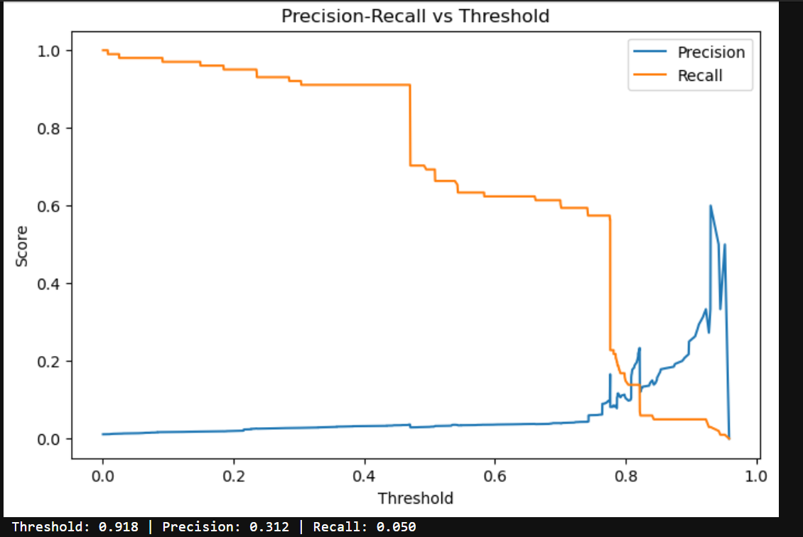
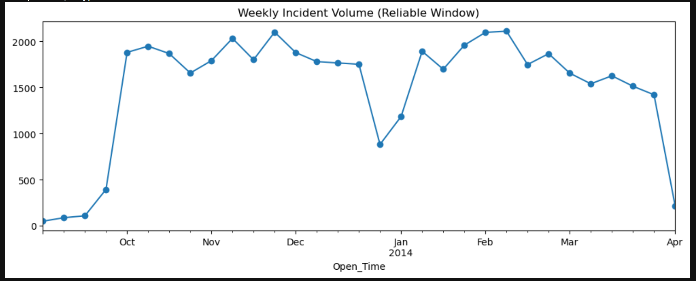

# ITSM Ticket Analytics with Machine Learning

Four ML tasks on ~46,600 real IT service-desk tickets for a fictional client, **ABC Tech** (DataMites capstone PM-PR-0012): predicting ticket priority, forecasting incident volume, auto-tagging tickets by CI category, and flagging tickets that will need a change request.

**Stack:** Python · pandas · scikit-learn · XGBoost · statsmodels · SQLAlchemy/MySQL · Jupyter

---

## Results at a glance

| # | Task | Final model | Result | Takeaway |
|---|------|-------------|--------|----------|
| 1 | Predict ticket priority (4 classes) | Random Forest, custom class weights | **77% accuracy, 0.65 macro-F1** (time-based split) | Which system a ticket belongs to is the strongest honest signal. Recall on the rarest, most urgent class is only 0.53, so this is a trade-off to discuss. |
| 2 | Forecast weekly incident volume | Holiday-aware naive forecast | **MAE 207 vs 226** for plain naive | Volume is flat. Moving average, linear trend and exponential smoothing all did *worse* than "same as last week". |
| 3 | Auto-tag CI category (11 classes) | Tuned XGBoost | **0.35 macro-F1** | Tuning gave no gain over defaults: the limit is feature signal, not the model. |
| 4 | Flag tickets linked to a change request (1.2% positive) | XGBoost, `scale_pos_weight=20` | **ROC-AUC 0.857** | Real signal on a very rare event; choosing the alert threshold is a business decision, shown as a trade-off table. |

These numbers come from a deliberately **leakage-free, time-based** evaluation, so they are lower than some figures you'll find online for this dataset (see the next section).

---

## The most interesting finding: why ~99% accuracy is fake

Other public solutions to this project report ~98.5% accuracy for priority prediction. In this dataset, `Priority` is computed from `Impact × Urgency` using a fixed matrix, so including those two columns lets a model look up the answer instead of learning anything.

I tested this directly (notebook section 4.1):

| Setup | Accuracy |
|---|---|
| **This project: no Impact/Urgency, time-based split** | **77%** |
| With Impact/Urgency, random split | 99.93% |
| With Impact/Urgency, time-based split | 99.97% |

`Impact` and `Urgency` alone account for ~77% of the model's feature importance. A near-perfect score on noisy, human-labelled ticket data is a symptom of target leakage, not of a better model.

A second, smaller leak was caught in Task 3: `CI_Subcat` maps to `CI_Cat` with ~98% purity, so it was excluded there.

---

## Data-quality problems found and handled

- **Corrupted `Handle_Time_hrs` column.** Values like `3,87,16,91,111` are decimal numbers whose decimal point was dropped and whose digits were then formatted with Indian-style digit grouping. The original decimal position can't be recovered, so the column was dropped and handle time re-derived from the open/close timestamps.
- **Hidden missing values.** `"NS"` and `"NA"` strings made `.info()` report zero nulls.
- **Blank ≠ missing.** Blanks in `No_of_Related_Changes` / `No_of_Related_Incidents` were verified (by inspecting non-null values) to mean "zero", not "unknown".
- **Pilot-period artifact.** The first ~19 months contain under 300 tickets in total, then volume jumps ~10x. This is a system roll-out artifact, so forecasting was restricted to the stable Oct 2013 to Mar 2014 window (26 weekly points).
- **Near-empty classes merged.** Priority 1 (3 tickets) into Priority 2; two CI categories (7 tickets total) into "Other".

## Scope changes (and why)

Two of the four goals in the brief couldn't be built literally because the fields don't exist in the data:

- **Department tagging → CI-category tagging.** No department or assignment-group column exists.
- **RFC failure prediction → change-request linkage.** No change success/failure outcome exists, so the model predicts whether a ticket gets linked to a change at all.

---

## Task 4 operating-point trade-off

At the default 0.5 threshold the full-weight model flags almost everything (3% precision). Two defensible thresholds from the stable part of the precision/recall curve:

| | Threshold ≈ 0.774 | Threshold ≈ 0.821 |
|---|---|---|
| Precision / Recall | 0.097 / 0.574 | 0.233 / 0.139 |
| Real change-linked tickets caught | 58 of 101 | 14 of 101 |
| Drawback | ~9 false alarms per real hit | Misses 86% of real cases |

Test set has only 101 positive examples, so thresholds past ~0.85 are noise and were ruled out.




---

## Repository structure

```
itsm-ticket-ml/
├── notebooks/01_itsm_ml_capstone.ipynb   # full analysis with outputs
├── reports/figures/                      # charts used in this README
├── data/README.md                        # where the data comes from
├── requirements.txt
├── .env.example                          # DB settings (placeholders only)
└── LICENSE
```

## Running it yourself

The data lives in a course-provided MySQL database and is not redistributed here, so you'll need your own access to it.

```bash
git clone https://github.com/<your-username>/itsm-ticket-ml.git
cd itsm-ticket-ml
python -m venv .venv && .venv\Scripts\activate      # Windows
pip install -r requirements.txt

# set ITSM_DB_HOST, ITSM_DB_USER, ITSM_DB_PASSWORD (see .env.example), then:
jupyter notebook notebooks/01_itsm_ml_capstone.ipynb
```

## Honest limitations

- Task 3 is weak (0.35 macro-F1) because the available fields can't separate rare categories.
- Task 4's test set has just 101 positives, so its metrics are noisy.
- The weekly forecast uses only 26 data points, so it is a short-horizon baseline, not a long-range forecast.
- Task 1 uses some post-ticket fields (reassignment and related-incident counts); a strict "at creation time" version would exclude them.
